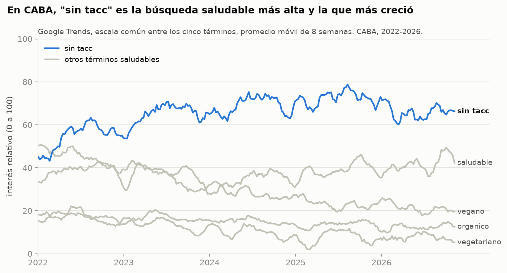
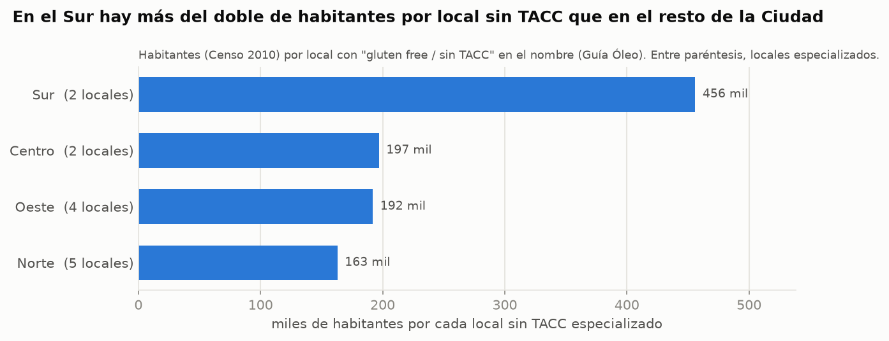

# Consulting Challenge — EcoFood

Consultoría de datos para **EcoFood**, una empresa que quiere lanzar una línea de productos alimenticios sostenibles en Buenos Aires. El trabajo cruza cuatro fuentes (oferta gastronómica registrada, búsquedas en Google, reseñas de consumidores y datos de población) para responder qué producto lanzar, dónde y qué cuidar.

## Respuesta corta

> **La oportunidad más concreta es una línea sin TACC (panificados, almacén, para llevar), con un primer test en Caballito y Balvanera.**

- **Producto:** en CABA, "sin tacc" es la búsqueda saludable más alta y la que más creció desde 2022. Es el tema saludable que más aparece en las reseñas, con lenguaje de escasez. Y la oferta especializada es mínima: 13 de 2.235 locales.
- **Zona:** cada análisis marca barrios distintos porque responde una pregunta distinta (ver [la reconciliación](#por-qué-cada-punto-marca-barrios-distintos)). Balvanera es el único que aparece en las tres miradas. Caballito es el mejor candidato específico para sin TACC.
- **Operación:** en el punto de venta, lo que más castiga una reseña es la espera. El precio no castiga a quien ya compró, pero estos datos no dicen si frena a quien no compra.

## Objetivo del cliente

Identificar zonas y categorías de Buenos Aires con mayor potencial para el lanzamiento de una línea de productos alimenticios sostenibles, y entender qué valora y qué castiga el consumidor.

## Fuentes de datos

| Archivo | Contenido | Origen | Punto |
|---|---|---|---|
| `data/raw/oferta_gastronomica.csv` | Oferta y Establecimientos Gastronómicos (2.823 registros crudos) | datos abiertos GCBA, publicado por el Ente de Turismo | 1, 4 |
| `data/raw/poblacion_por_barrio.csv` | Población por barrio, Censo 2010 | datos abiertos GCBA | 1, bonus |
| `data/raw/barrios_caba.geojson` | Polígonos, comuna y superficie de los 48 barrios | datos abiertos GCBA | 1, 3, bonus |
| `data/raw/espacios_verdes.csv` | 2.176 espacios verdes con superficie | datos abiertos GCBA | 1 |
| `data/raw/trends_juntos.csv` | Interés semanal de 5 términos, Argentina, nov-2021 a nov-2026 | Google Trends vía `pytrends` | 2 |
| `data/raw/trends_control_caba.csv` | Control con palabras cotidianas, solo CABA, con fechas | Google Trends vía `pytrends` | bonus |
| `data/raw/guiaoleo_restaurantes.jsonl` | 2.318 restaurantes de CABA con 1.075 reseñas públicas (captura vigente) | scraping de Guía Óleo | 3, bonus |
| `data/raw/guiaoleo_captura.json` | Fecha de la captura vigente y resultado del último intento de actualizarla | generado por el scraper | 3 |
| `data/processed/establecimientos_clean.csv` | Oferta limpia (2.811 locales) | notebook 01 | 1, 3, 4, bonus |
| `data/processed/barrios_sin_registro.csv` | Barrios oficiales sin ningún local (Parque Chas) | notebook 01 | 1 |
| `data/processed/resenas_clean.csv` | 1.075 reseñas limpias con barrio, puntajes y precio | notebook 03 | 3, bonus |

**Ninguna fuente es un censo del mercado.** El registro del GCBA lo publica el Ente de Turismo y Guía Óleo cubre locales con visibilidad en la guía. Las dos reparten la oferta muy distinto (el Centro pesa 39% en una y 18% en la otra), así que las conclusiones geográficas hablan de **oferta registrada**.

## Metodología

| Paso | Notebook | Qué hace |
|---|---|---|
| Limpieza de la oferta | `01_limpieza_oferta.ipynb` | Repara encoding, normaliza a los 48 barrios oficiales, elimina 12 duplicados, etiqueta nulos como `SIN DATO` y crea `es_saludable_estricto`, `es_saludable_amplio` y `zona`. |
| Punto 1 — Oferta | `02_eda_oferta.ipynb` | Siete miradas en paralelo: volumen y concentración, densidad por habitante y por km², composición de rubros, nivel de precio revelado, espacios verdes, oferta saludable y cruce final. |
| Punto 2 — Tendencias | `google_trends_ecofood_eda.ipynb` | Interés de búsqueda de 5 conceptos en Argentina a 5 años, en escala común y por separado. |
| Punto 3 — Reseñas | `03_resenas_punto3.ipynb` | Scraping ético de Guía Óleo, barrio por punto en polígono, puntajes por dimensión, temas por diccionario y cruce con los puntos 1 y 2. |
| Punto 4 — Competencia | `punto4_competencia_oportunidades.ipynb` | Corte del dataset del punto 1 por rubro y tipo de cocina: qué está sobrerrepresentado y qué falta. |
| Bonus | `04_bonus_busqueda_vs_oferta.ipynb` | Búsqueda alta contra oferta baja, por concepto y por zona. |

**Definición de "saludable"** (decisión del equipo, sobre la columna `cocina` del GCBA): **estricto** = `NATURISTA` + `VEGETARIANA` (11 locales); **amplio** = estricto + `MEDITERRANEA`, `SUSHI`, `JAPONESA` (80 locales). En Guía Óleo, la oferta especializada se identifica por el nombre del local.

**Cómo se descartan explicaciones alternativas**, que es lo que pide la consigna:

- **Umbral de volumen:** ningún barrio entra a un ranking con menos de 20 locales.
- **Comparación contra el azar:** una binomial dice si un barrio con pocos locales saludables se distingue de lo esperable.
- **Test de dos proporciones:** dice si un tema aparece de verdad más en las reseñas peor puntuadas.
- **Diccionarios revisados por contexto:** se leyó cada palabra dudosa ("tener en cuenta" no es precio; "rápido" no es espera).
- **Control de palabras en Trends:** separa el interés real de la elección de términos.
- **Comparación entre fuentes:** GCBA contra Guía Óleo, para ver qué conclusiones dependen de la fuente.

## Scraping ético y captura de respaldo

El punto 3 no tiene dataset: hay que ir a buscar el dato. Antes de escribir código se verificó si el sitio permite que un programa lo lea:

| Fuente | `robots.txt` | Términos de uso | Resultado |
|---|---|---|---|
| Google Maps | bloquea rutas de contenido | prohíbe extracción automatizada | descartado |
| TripAdvisor | `Disallow` sobre `/AllReviews`, `/api` y cientos de rutas | prohíbe scraping | descartado |
| **Guía Óleo** | `Allow: /` para `*`; bloquea solo `/admin/`, `/api/`, `/search?`, `/map?` | no prohíbe la lectura automatizada | **elegido** |

El scraper (`scripts/scrape_guiaoleo.py`):

- Usa un user-agent honesto (`ConsultingChallenge-EcoFood/1.0`) y no simula un navegador.
- Hace como máximo 3 pedidos en paralelo, con pausa (≈2 por segundo).
- Vuelve a leer el `robots.txt` antes de empezar.
- Pide solo páginas públicas del sitemap.
- Es reanudable.

Se bajó el **98,9%** de las reseñas que el sitio declara para CABA (1.075 de 1.087): es prácticamente toda la comunidad de Guía Óleo en CABA, no una muestra. El límite es que esa comunidad es chica y nueva (todas las reseñas son del último año).

**Captura de respaldo:** cada corrida escribe en un archivo parcial y solo reemplaza a la captura vigente si pasa la validación. La validación pide tres cosas:

- al menos 90% del sitemap bajado;
- nombres bien parseados;
- no perder la mitad de las reseñas.

Si falla algo (sin red, sitio caído, `robots.txt` que deja de permitir, rediseño que rompe el parser), **se sigue usando la última captura buena**. El motivo queda en `guiaoleo_captura.json` y el notebook lo avisa al cargar. El notebook del bonus aplica la misma lógica a Google Trends.

## Hallazgos por punto

### Punto 1 — Oferta gastronómica

- **La oferta registrada está concentrada:** 5 barrios (Palermo, San Nicolás, Recoleta, Balvanera, Monserrat) reúnen el 57% de los locales del GCBA. En Guía Óleo el top 5 es otro (Palermo, Recoleta, Villa Devoto, Belgrano, Caballito): la concentración en el centro depende de la fuente.
- **El segmento saludable es chico:** 2,85% de los locales con el criterio amplio y 0,4% con el estricto. El Norte tiene el mayor peso (4,8%) y el Sur casi no tiene (1 local en 363).
- **Brechas de segmento:** 16 barrios tienen un peso saludable bajo la media. Solo 3 se distinguen del azar (p < 0,10): Balvanera, Monserrat y Flores. Hay que leerlo con cuidado por dos motivos:
  - Balvanera tiene 31% de locales sin tipo de cocina cargado, contra 12,7% de la Ciudad, así que parte de su "brecha" puede ser dato faltante.
  - Al probar 16 barrios a la vez, algún falso positivo es esperable.
- **23 de 47 barrios no son concluyentes:** tienen menos de 20 locales.
- La relación entre oferta saludable, perfil de precio y espacio verde es débil y en parte mecánica: no se toma como señal de demanda.

### Punto 2 — Tendencias de búsqueda

Interés medio por año en Argentina, escala común entre los cinco términos:

| Término | 2022 | 2025 | Dirección |
|---|---|---|---|
| sin TACC | 64,2 | 80,2 | crece |
| alimentación saludable | 5,4 | 3,2 | cae |
| alimentos naturales | 2,2 | 1,7 | estable / baja |
| café de especialidad | 0,1 | 1,3 | crece desde casi cero |
| veganismo | 2,0 | 0,1 | casi desaparece |

La distancia enorme entre "sin TACC" y el resto se explica en parte por cómo se eligieron los términos: se compara un rótulo corto con frases que casi nadie busca tal cual. El control del bonus lo corrige (ver abajo). La dirección no cambia.

### Punto 3 — Reseñas de consumidores

Sobre 1.075 reseñas (948 con texto y 486 con un precio válido):

- **La comida es lo mejor puntuado** (2,35 sobre 3, 48% "Excelente"); servicio (2,21) y ambiente (2,20) quedan abajo.
- **Lo que más castiga una reseña es la espera:** aparece en 8,1% de las reseñas peor puntuadas contra 2,4% de las mejores (p = 0,003). Con un corte más estricto, en 13,2% contra 2,4%. La atención va al revés: se nombra para elogiar.
- **Entre quienes ya fueron, el precio no predice la satisfacción:** r = 0,12 entre precio y puntaje. El precio se menciona parecido en las reseñas peor y mejor puntuadas (18,4% contra 15,7%, p = 0,38).
- **Lo saludable que se menciona es sobre todo sin TACC:**
  - 4,1% de las reseñas toca algo saludable, que no es poco frente a una oferta saludable de 0,4% a 2,85%.
  - De esas 39, 20 hablan de celiaquía, y 6 de esas 20 con lenguaje de escasez ("de esos pocos refugios", "no se consigue en todos lados").
- **El proxy de poder adquisitivo del punto 1 queda parcialmente validado:**
  - La oferta saludable correlaciona con el precio declarado (mediana r = 0,43, media r = 0,54).
  - No correlaciona con el porcentaje de reseñas caras.
  - El proxy de ambientación premium no se sostiene (r negativo).

### Punto 4 — Competencia y oportunidades

- **Casi no hay competencia directa:** 11 locales saludables estrictos de 2.811 (0,4%). El criterio amplio suma 80, pero la mayoría es mediterránea (48) o sushi/japonesa (21), no una propuesta naturista o vegetariana.
- **Lo que existe está en Palermo:** 33 de los 80 locales saludables amplios (41%).
- **Faltan formatos:**
  - 1 de 332 cafés es saludable estricto.
  - Los 2 locales de take away son de sushi.
  - El registro no tiene ninguna categoría para vegano ni para sin TACC.
- Propone como zonas más claras a **Flores, Almagro, Barracas y La Boca**: tienen 40 locales o más y ningún saludable. Con el chequeo contra el azar del punto 1, solo Flores se distingue. En Almagro, Barracas y La Boca, ver cero es esperable (p entre 0,16 y 0,28).

### Bonus — búsqueda alta contra oferta baja

**¿Dónde hay alta búsqueda y baja oferta? En sin TACC.** Un control propio en Google Trends, con palabras cotidianas y solo en CABA, confirma el resultado del punto 2 con una ventaja más chica (1,7 veces, no casi 20):

| Concepto | Búsqueda en CABA (media 5 años) | Tendencia 2022-2025 | Oferta especializada |
|---|---|---|---|
| sin TACC | 65 (la más alta) | crece (+17) | 13 de 2.235 locales de Guía Óleo (0,6%); el GCBA no tiene la categoría |
| vegano / vegetariano | 42 (dos términos sumados) | cae (−31) | 4 en el GCBA, 4 en Guía Óleo |
| saludable / orgánico | 53 (dos términos sumados) | plana (−3) | 7 en el GCBA, 2 en Guía Óleo |

**¿Qué zonas?** Trends no baja a barrio, así que se supone que la necesidad sigue a la población. Es razonable para la celiaquía, que es una condición médica y no una preferencia.

- **El Sur es la zona menos atendida:** 456 mil habitantes por local sin TACC especializado, más del doble que el resto (163 a 197 mil). Fuera de Almagro no tiene ninguno.
- **Caballito es el barrio candidato más sólido:** 176 mil habitantes, 139 locales en Guía Óleo y ninguno sin TACC especializado. Le siguen Balvanera, Villa Urquiza, Villa Crespo y Retiro.
- Flores, Villa Lugano, Barracas y Mataderos quedan afuera: tienen tan poca gastronomía en Guía Óleo que su cero no dice nada.
- Ningún barrio es una brecha contra el azar (con 0,6% de locales especializados, ver cero es esperable). La oferta sin TACC es mínima en toda la Ciudad.





## Por qué cada punto marca barrios distintos

Los puntos no se contradicen: **responden preguntas distintas, con fuentes y definiciones distintas.**

| Mirada | Pregunta | Fuente | Qué cuenta como oferta | Barrios que marca |
|---|---|---|---|---|
| Punto 1 | ¿Dónde la gastronomía tiene menos peso saludable del esperable por azar? | GCBA | cocina saludable | Balvanera, Monserrat, Flores |
| Punto 4 | ¿Dónde hay 40 locales o más y ningún saludable? (sin test de azar) | GCBA | cocina saludable | Flores, Almagro, Barracas, La Boca |
| Bonus | ¿Dónde vive más gente lejos de un local sin TACC? | Guía Óleo + Censo | sin TACC en el nombre | Sur (zona); Caballito, Balvanera, Villa Urquiza, Villa Crespo, Retiro |

Cruzadas barrio por barrio:

| Barrio | Punto 1 | Punto 4 | Bonus | Lectura |
|---|---|---|---|---|
| **Balvanera** | se distingue del azar (con 31% de cocina sin dato) | sí | candidato | **el único que aparece en las tres** |
| **Caballito** | ya tiene oferta saludable (4 locales) | no | el mejor candidato | tiene saludable genérico pero cero sin TACC: **la brecha es de producto, no de barrio** |
| **Flores** | se distingue del azar | sí | afuera | depende de la fuente: 85 locales en el GCBA, 11 en Guía Óleo |
| **Monserrat** | se distingue del azar | sí | no evaluado (40 mil habitantes) | solo lo marca el GCBA |
| **Almagro, Barracas, La Boca** | no se distinguen del azar | sí | Almagro tiene 2 locales sin TACC; Barracas y La Boca, poca gastronomía | la evidencia más débil |
| **Sur (zona)** | casi no hay oferta saludable | — | la más desatendida por habitante | necesidad alta y poder de compra desconocido |

## Síntesis: 3 insights ejecutivos

### 1. La oportunidad de producto es sin TACC, no "lo saludable" en general

Tres fuentes independientes apuntan al mismo lugar:

- **Búsqueda:** es el término saludable más buscado en CABA y el que más creció (+17 puntos desde 2022), mientras "vegano" cae a la mitad.
- **Reseñas:** es el tema saludable más mencionado, con lenguaje de escasez.
- **Oferta:** la especializada es de 13 locales en 2.235.

- *Alternativa evaluada: es un artefacto de las palabras elegidas.* **Parcialmente cierta:** la ventaja era menor de lo que parecía (de casi 20 veces a 1,7), pero con palabras cotidianas sigue primero y es la única que crece.
- *Alternativa evaluada: las reseñas celíacas son quejas.* **Descartada:** puntúan casi igual que el resto (2,17 contra 2,25).

### 2. La brecha es de producto, no de barrio: Caballito y Balvanera para empezar

Que un barrio tenga cero locales saludables no es, por sí solo, una oportunidad:

- con oferta tan escasa, ver cero es lo esperable en la mayoría de los barrios;
- la "concentración en el centro" depende de la fuente.

Lo que sí se sostiene:

- **Balvanera** es el único barrio que marcan las tres miradas.
- **Caballito** muestra la tesis en un solo barrio: tiene oferta saludable genérica pero ninguna sin TACC.
- **El Sur** tiene la necesidad más alta por habitante, pero también la menor actividad gastronómica y un poder de compra que no se puede medir con estos datos.

- *Alternativa evaluada: los barrios con cero oferta son la oportunidad.* **Descartada** para Almagro, Barracas y La Boca: no se distinguen del azar.
- *Alternativa evaluada: la concentración del centro es del mercado.* **Descartada:** el Centro pesa 39% en el registro de Turismo y 18% en Guía Óleo.

### 3. En el punto de venta, lo que castiga es la espera; el precio no castiga a quien ya compró

La espera es el único tema que separa con firmeza las reseñas peor puntuadas de las mejores (8,1% contra 2,4%, p = 0,003). La comida es lo mejor puntuado y el precio se menciona parecido en reseñas buenas y malas (sin diferencia significativa).

- *Alternativas descartadas:*
  - **Efecto techo en los puntajes:** las tres dimensiones usan toda la escala.
  - **Reseñas malas más largas:** el largo es casi igual.
  - **"Rápido" contado como espera:** el diccionario se corrigió y el hallazgo sobrevive con números más chicos.
- *No descartada: sesgo de supervivencia.* Quien no compra porque le parece caro no reseña: estos datos no dicen si el precio es una barrera de entrada.

## Recomendaciones

1. **Producto:** lanzar como primera apuesta una línea **sin TACC** orientada a panificados, almacén y productos para llevar. Antes de invertir, medir el tamaño de la demanda (encuesta) y relevar la oferta sin TACC en dietéticas y supermercados, que es la competencia real de un producto y no está en ningún dataset de este trabajo.
2. **Zona:** hacer el primer test en **Caballito** (mucha población, gastronomía activa, cero oferta sin TACC especializada) y en **Balvanera** (el barrio que marcan las tres miradas; su precio declarado es el más bajo de los candidatos, 20 mil por persona, así que conviene testear precio). **Postergar el Sur por incertidumbre, no descartarlo:** es la zona menos atendida, pero falta saber si puede pagar el producto.
3. **Operación y precio:** si se vende en local propio o a través de cafés, cuidar el tiempo de espera; los formatos para llevar lo evitan. Fijar el precio con un test de góndola: las reseñas no miden la barrera de entrada.

## Limitaciones

- **Ninguna fuente de oferta es un censo:** el GCBA registra lo que le interesa al turismo y Guía Óleo, lo que tiene visibilidad. Además, la oferta medida es de **gastronomía**: no cubre supermercados ni dietéticas.
- **No hay datos de ingreso:** el poder adquisitivo se aproxima con la composición de la oferta y con el precio declarado en reseñas, y queda parcialmente validado.
- **La población es del Censo 2010.**
- **La definición de "saludable" es una decisión del equipo** y los resultados cambian si cambia. La oferta sin TACC se cuenta por el nombre del local, así que es una cota inferior.
- **Las reseñas son de quien escribe reseñas.** Es una comunidad chica y nueva (1.075 reseñas, todas del último año), y el scraper no identifica autores, así que no se sabe cuántas personas distintas escribieron.
- **Las reseñas son de quien ya compró:** no pueden medir si el precio frena a quien no compra.
- **El análisis de texto usa diccionarios, no un modelo:** es auditable, pero puede fallar con ironía y negaciones.
- **Google Trends es relativo:** dice qué se busca más, no cuánta gente busca. `trends_juntos.csv` se guardó sin fechas; el bonus las reconstruye verificando las primeras filas contra el notebook del punto 2.
- **Las zonas del bonus dependen de un supuesto:** que la necesidad sin TACC sigue a la población.
- **"Sur" es la agrupación de comunas del punto 1** (4, 5, 8, 9 y 10). Incluye barrios del suroeste como Liniers o Floresta.
- **Parque Chas no tiene registros:** no se puede afirmar que no tenga oferta.

## Presentación

En `presentation/`:

- `presentacion_ecofood.pptx`: deck ejecutivo de 10 diapositivas (16:9).
- `presentacion_ecofood.pdf`: exportación del deck para proyectar o imprimir.
- `presentacion_ecofood.html` / `index.html`: versión web del deck, con navegación por teclado.
- `guion_presentacion.md`: guion del orador, con tiempos por slide y respuestas a preguntas difíciles.

Los gráficos del deck salen de `images/`: el punto 1 genera `01` a `03`, el punto 3 `04` a `07` y el bonus `08` y `09`.

## Estructura del repositorio

```text
├── data/
│   ├── raw/          # fuentes originales, capturas de Trends y del scrape
│   └── processed/    # datos limpios (oferta y reseñas)
├── notebooks/        # 01 limpieza, 02 oferta (punto 1), Trends (punto 2), 03 reseñas (punto 3),
│                     # competencia (punto 4), 04 bonus
├── scripts/          # scraper de Guía Óleo y generadores del deck
├── images/           # gráficos para el deck
├── presentation/     # deck ejecutivo y guion
└── README.md
```

## Cómo reproducir

```bash
python -m venv .venv && source .venv/bin/activate
pip install pandas numpy matplotlib jupyter requests beautifulsoup4 lxml pytrends python-pptx
cd notebooks
jupyter lab
```

Orden de ejecución:

1. `01_limpieza_oferta.ipynb`: regenera `data/processed/establecimientos_clean.csv`.
2. `02_eda_oferta.ipynb`: punto 1, gráficos `01` a `03`.
3. `punto4_competencia_oportunidades.ipynb`: punto 4.
4. `03_resenas_punto3.ipynb`: punto 3; regenera `data/processed/resenas_clean.csv` y los gráficos `04` a `07`.
5. `04_bonus_busqueda_vs_oferta.ipynb`: bonus, gráficos `08` y `09`. Usa la captura guardada de Trends; con `ACTUALIZAR_TRENDS = True` intenta consultar de nuevo y, si falla, sigue con la guardada.

**No hace falta correr `google_trends_ecofood_eda.ipynb`:** vuelve a consultar Google Trends y pisa `trends_juntos.csv` con datos nuevos. El bonus verifica que las primeras filas coincidan y se detiene si no.

Para actualizar el scrape de Guía Óleo (opcional, unos 18 minutos, reanudable; si falla se mantiene la captura anterior):

```bash
python scripts/scrape_guiaoleo.py              # actualiza la captura vigente
python scripts/scrape_guiaoleo.py --limit 20   # muestra de prueba, no toca la vigente
```

Para regenerar el deck, desde la carpeta que **contiene** el repositorio (los scripts usan rutas relativas a esa carpeta):

```bash
python Consulting-Challenge-Data-analytics/scripts/generar_deck.py        # .pptx
python Consulting-Challenge-Data-analytics/scripts/generar_html_deck.py   # .html e index.html
```
